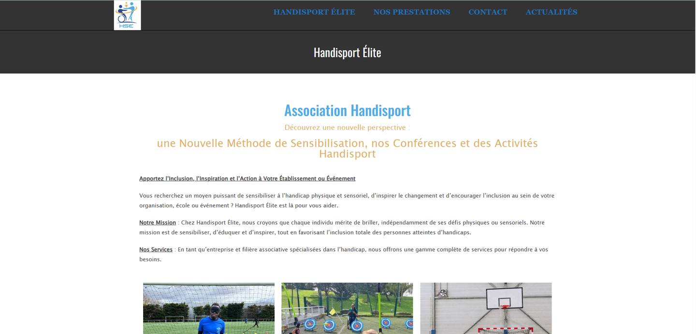
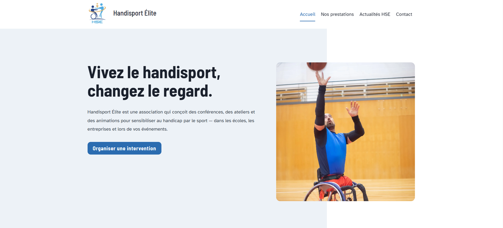

# Refonte accessible — Handisport Élite

Étude de cas : refonte d'un site WordPress associatif avec une optimisation
d'accessibilité de premier niveau (WCAG 2.1 AA, bonnes pratiques RGAA 4.1).

**Client** : [Handisport Élite](https://handisportelite.com) — association de
sensibilisation au handicap par le sport, intervenant dans les écoles, les
entreprises et lors d'événements.

**Rôle** : conception UX/UI et intégration — *Marjorie Ngoupende, web designer
indépendante*

**Période** : septembre – octobre 2026

> ⚠️ *Périmètre : optimisation de premier niveau. Cette mission ne constitue
> ni un audit RGAA complet, ni une déclaration d'accessibilité. Aucun taux de
> conformité n'est revendiqué.*

---

## Le contexte

Une association dont le métier est de sensibiliser au handicap disposait d'un
site que les personnes en situation de handicap ne pouvaient pas utiliser
confortablement. Le décalage entre le propos et l'outil était le point de
départ de la mission.

Le site existant présentait plusieurs obstacles : textes en bleu clair sur
fond blanc, contenu gravé dans les images, structure de titres incohérente,
et une dépendance à un constructeur de pages lourd pour un site de cinq pages.

Les arbitrages d'accessibilité ne se sont pas faits dans l'abstrait : ils se
vérifiaient directement auprès de l'association, dont les membres pratiquent
quotidiennement ce que le site est censé rendre possible.

## La page d'accueil, avant et après

| Avant | Après |
|---|---|
|  |  |

Trois problèmes coexistent dans la version de gauche. Le titre
« Association Handisport » est en bleu ciel, le sous-titre et le grand titre en
or clair : les trois passent sous le seuil de contraste exigé sur fond blanc.
Le corps du texte emploie « personnes atteintes d'handicaps », qui cumule
l'élision fautive du h aspiré et une formulation que le secteur n'emploie
plus. Et la page ouvre sur trois paragraphes avant de proposer la moindre
action.

À droite, le message tient en une phrase, le texte est en encre sur fond
clair, et une seule action est proposée.

## Ce qui a été fait

### Fondations techniques

Passage d'Elementor à **Kadence**, en Gutenberg natif, sans constructeur de
pages. Le choix était double : alléger le site, et surtout produire un
balisage HTML propre, condition de toute accessibilité réelle.

Aucun *overlay* d'accessibilité n'a été installé. Ces surcouches promettent
une mise en conformité automatique ; elles dégradent en pratique l'expérience
des utilisateurs de lecteurs d'écran et ne corrigent pas les causes.

### Design system accessible

Une palette construite sur les ratios de contraste, avec une règle explicite
séparant les couleurs **décoratives** des couleurs utilisables pour du texte.

| Rôle | Hex | Contraste |
|---|---|---|
| Marine — liens, boutons, titres | `#2D4987` | 8,7:1 sur blanc |
| Encre — texte courant, fonds sombres | `#16233F` | — |
| Ciel lisible — texte secondaire | `#417393` | 5,1:1 sur blanc |
| Or lisible — texte sur fond clair | `#826433` | 5,5:1 sur blanc |
| Ciel — **décoratif uniquement** | `#5EA5D3` | insuffisant pour du texte |

**Typographie** : [Atkinson Hyperlegible](https://www.brailleinstitute.org/freefont/)
en 18 px pour le texte courant — une police conçue par le Braille Institute
pour la basse vision, qui différencie les caractères habituellement confondus
(I majuscule, l minuscule, 1). Barlow Semi Condensed pour les titres.

**Focus clavier** : anneau de 3 px, marine sur fond clair, doré sur fond
sombre — parce qu'un anneau marine sur un fond marine est invisible.

```css
a:focus-visible,
button:focus-visible {
  outline: 3px solid #2D4987;
  outline-offset: 2px;
  border-radius: 3px;
}

.has-dark-background a:focus-visible {
  outline-color: #DAA856;
}
```

### Corrections structurelles

**Hiérarchie des titres.** Le gabarit de départ contenait des paragraphes
balisés en titres et des titres de même niveau pour des contenus imbriqués.
Pour un utilisateur de lecteur d'écran, qui navigue souvent de titre en titre,
cette arborescence faussée rend la page illisible dans sa logique. Chaque bloc
a été repris : un seul `<h1>`, puis une imbrication sans saut de niveau.

**Alternatives textuelles.** Rédigées depuis la médiathèque pour se propager
partout. Les images décoratives et le logo — redondant avec le nom affiché à
côté — portent une alternative vide plutôt qu'une description inutile.

**Liens.** Quatre liens de réseaux sociaux avaient un `href` vide : visibles,
annoncés par les lecteurs d'écran, mais ne menant nulle part et occupant
quatre arrêts inutiles dans le parcours clavier.

**Lien d'évitement.** Présent mais affiché en anglais. La cause n'était pas le
thème : la langue du site était restée sur l'anglais, ce qui laissait non
traduits tous les textes d'interface — y compris ceux qui ne sont annoncés
qu'aux lecteurs d'écran.

### Contenu

Reprise des textes existants avec la terminologie recommandée :
« le handicap » (h aspiré), « personnes en situation de handicap » plutôt que
« atteintes de », « personnes sourdes ou malentendantes ».

Remplacement des photographies génériques par les **photos réelles de
l'association** — ateliers, cécifoot, basket en fauteuil, tir à l'arc.

## Méthode de contrôle

Le scan automatique (Equalize Digital Accessibility Checker) a servi de
premier filet : **5 erreurs bloquantes ramenées à 0**, sur deux motifs —
contraste insuffisant et liens sans destination.

Mais les outils automatiques ne couvrent qu'environ **30 % des critères**. Ce
qu'ils ne voient pas : la pertinence d'une alternative textuelle, la logique
de l'ordre de lecture, la clarté d'un intitulé de lien hors contexte. Le reste
s'est vérifié à la main — navigation clavier complète, et test lecteur d'écran.

## Ce que je retiens

**Le gabarit de départ est le premier adversaire.** Un *starter template*
commercial produit des faux titres, des liens vides et des couleurs
décoratives appliquées à du texte. Chaque bloc hérité demande une
vérification.

**L'accessibilité se fait pendant, pas après.** Corriger une hiérarchie de
titres sur une page construite coûte bien plus cher que de la poser
correctement.

**Une couleur conforme ne suffit pas.** Un lien signalé par la seule couleur
disparaît en vision monochrome, en contraste élevé, et pour une partie des
personnes daltoniennes. Le soulignement n'est pas une option esthétique.

---

## Stack

WordPress · Kadence · Gutenberg · CSS · Equalize Digital Accessibility
Checker · WP Accessibility · NVDA

## Liens

- Préproduction : [staging.handisportelite.com](https://staging.handisportelite.com)
  — *version de travail, en attente de mise en ligne*
